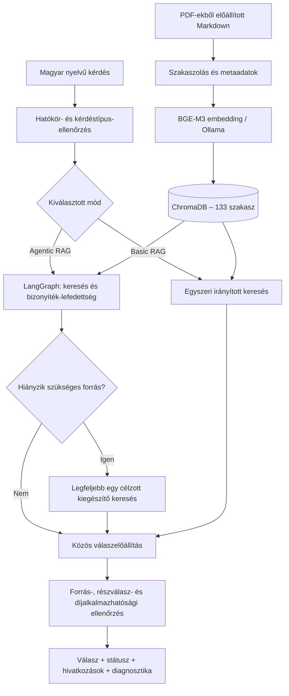

# OTP Diákhitel Számla – lokál Basic és Agentic RAG PoC

**Magyar nyelvű, dokumentumalapú kérdés–válasz prototípus, Basic RAG és LangGraph-alapú Agentic RAG összehasonlításával.**

| Projektjellemző | Megvalósítás |
|---|---|
| Állapot | Egyetemi *Proof-of-Concept* (PoC) |
| Nyelv | Magyar |
| Futtatás | Helyi gépen, Windows / PowerShell / VS Code környezetben |
| Nyelvi modell | Ollama – `qwen2.5:3b` |
| Embedder modell | Ollama – `bge-m3` |
| Vektortár | ChromaDB, perzisztens helyi gyűjtemény |
| RAG keretrendszer | LangGraph |
| UI kliens | Streamlit |
| Corpus | 4 forrásdokumentum, összesen 133 indexelt szakasz |

> [!IMPORTANT]
> **Ez a projekt oktatási és kutatási célú demonstráció, nem az OTP Bank hivatalos ügyféltájékoztató rendszere.** A válaszok tévesek vagy hiányosak lehetnek. A betöltött dokumentumok meghatározott időpontokhoz kötődnek; a rendszer nem ellenőrzi automatikusan a bank jelenleg hatályos kondícióit. Pénzügyi döntéshez a hivatalos, aktuális banki dokumentumokat kell figyelembe venni.

## 1. A projekt célja és hatóköre

A projekt célja annak vizsgálata, hogy egy korlátozott hardver-erőforrással, teljesen lokál módon működtetett RAG (*Retrieval-Augmented Generation*) rendszer milyen mértékben képes magyar nyelvű, komplex banki dokumentumokból **forrással alátámasztott, ellenőrizhető válaszokat** adni.

**Üzleti cél:** az OTP Diákhitel számlával kapcsolatos, több dokumentumban megtalálható feltételek, díjak, fogalmak és szerződéses szabályok keresésének és értelmezésének támogatása.

**Technikai cél:** két azonos corpuson és válaszellenőrzési logikán alapuló megközelítés összehasonlítása:

- **Basic RAG:** dokumentum-visszakeresés, forrásalapú válasz előállítás és ellenőrzés egy alapfolyamatban.
- **Agentic RAG:** Gráf-alapú feltételes folyamat, amely hiányzó bizonyíték esetén **legfeljebb egy további, célzott visszakeresést** végezhet.

A rendszer a lakossági Diákhitel számla termékre koncentrál. Nem általános banki tanácsadó, nem használ ügyféladatbázist, nem kezdeményez tranzakciót, és nem váltja ki a banki ügyintézést vagy tájékoztatást.

## 2. Funkciók

- Magyar nyelvű kérdések megválaszolása a betöltött dokumentumok alapján.
- Dokumentum- és terméktípus szerinti, irányított keresés ChromaDB-ben.
- Díjak és számlafeltételek strukturált kinyerése, egyes üzleti szabályok determinisztikus ellenőrzésével.
- Jogszabályi/szerződéses kérdésekre forrásszakaszok alapján összeállított válaszok.
- Összetett kérdések részekre bontása a támogatott minták esetén; a hiányzó részválaszok jelzése.
- Forráshivatkozások, oldalszámok, szakaszazonosítók és ellenőrzött szövegrészletek megjelenítése.
- Díjalkalmazhatósági védelem bizonyos hibás csatorna-, földrajzi és időbeli megfeleltetésekkel szemben.
- Válaszstátuszok: `answered`, `partial`, `insufficient`.
- Basic és Agentic mód külön futtatása vagy összehasonlítása Streamlitben.
- LangGraph-lépések, keresési körök, újraírások, kérdésrész-diagnosztika és válaszidők megtekintése.
- Beszélgetésnapló exportálása CSV-fájlba; automatizált és kézi kiértékelés támogatása.

A dokumentum- és idézetellenőrzés **nem azonos** egy általános szemantikus tényellenőrző rendszerrel. A részletes korlátokat a [Korlátok](#10-korlátok-és-felhasználási-figyelmeztetések) szakasz ismerteti.

## 3. Rendszerarchitektúra



Mindkét mód **ugyanazt a corpust, embedding modellt és közös válasz előállítási és ellenőrzési logikát** használja. Az összehasonlításban az Agentic RAG lehetséges többlete elsősorban a hiányzó bizonyíték megszerzése, nem egy másik vagy nagyobb nyelvi modell használata.

A LangGraph **korlátozott, részben szabályvezérelt ügynöki működést** biztosít. A célzott visszakeresés bizonyos útvonalakon előre definiált forrásszerepekre épül, nem tekinthető autonóm, tetszőleges banki/jogi következtetésnek.

## 4. Adatforrások és előfeldolgozás

| Forrás | Dátum / hatály | Indexelt reprezentáció | Szakaszok |
|---|---|---|---:|
| OTP Diákhitel Számla – Díjjegyzék | 2026.09.01-i dokumentum | `Dijjegyzek_OTP_Diakhitel_szamla_20260901-rag.md` | 29 |
| Hirdetmény az OTP Diákhitel Számláról | Hatályos: 2025.11.18-tól | `Diakhitel_Szamla_H_20251118-rag.md` | 12 |
| Banki glosszárium | Dátum nélküli/Mindenkori| `Glosszarium-rag.md` | 21 |
| Fizetési számlák (bankszámlák) üzletszabályzata | Hatályos: 2026.10.15-től | `USZ_LAK_Bankszamla_20261015-knowledge.md` | 71 |
| **Összesen** | | | **133** |

A dokumentumok feldolgozása két, egymást kiegészítő Markdown-típust használ:

- **`*-rag.md`:** forráshű, oldal- és szakaszazonosítókra épülő strukturált átirat.
- **`*-knowledge.md`:** értelmezett, tematikus, önmagában is érthető tudásszakaszok a visszakeresés támogatására.

A 49 oldalas üzletszabályzatból **a 71 tudásszakasz kerül vektoros indexelésre**; a forráshű `-rag.md` a visszaellenőrzéshez marad meg. Emiatt a tudásdokumentumból vett idézet **nem feltétlenül szó szerinti PDF-idézet**. Lényeges szerződéses megállapítást az eredeti PDF-fel és a forráshű átirattal is ellenőrizni kell.

A források hatálya és az eltérő dokumentumtípusok elsőbbsége lényeges: egy általános üzletszabályzati vagy más számlatermékre vonatkozó díj nem alkalmazható automatikusan a Diákhitel Számlára.

### Vector store beállítások

A `src/config.py` szerinti fő konfiguráció:

```python
COLLECTION_NAME = "otp_diakhitel_regulation_v2"
EMBEDDING_MODEL = "bge-m3"
OLLAMA_BASE_URL = "http://localhost:11434"
CHROMA_PATH = PROJECT_ROOT / "chroma_db"
```

A `133` szakasz az adott négydokumentumos, v2-es gyűjteményre vonatkozik. Dokumentumváltoztatás esetén a darabszám és az értékelhetőség is módosulhat.

## 5. Telepítés és gyors indítás

### Előfeltételek

- Python 3.13.x és kompatibilis pip rendelkezésre áll.
- [Ollama](https://ollama.com/) telepítve és elindítva.
- A lokális `qwen2.5:3b` és `bge-m3` modellek elérhetőek.
- A szükséges Python-csomagok telepítve (LangChain, LangGraph, ChromaDB, Ollama kliens, Streamlit, pytest) a `requirements.txt` alapján.

### 5.1. Virtuális környezet (Windows PowerShell)

A projekt reprodukálhatóságához ajánlott virtuális környezet használata,a  fejlesztés alatt egyszerű venv került alkalmazásra, de uv is alkalmas.

### 5.2. Ollama modellek

```powershell
ollama pull qwen2.5:3b
ollama pull bge-m3
ollama list
```

Az Ollama helyi szolgáltatásának futnia kell. Alapértelmezett címe: `http://localhost:11434`.

### 5.3. Feldolgozott dokumentumok

```text
data/
└── processed/
    ├── Dijjegyzek_OTP_Diakhitel_szamla_20260901-rag.md
    ├── Diakhitel_Szamla_H_20251118-rag.md
    ├── Glosszarium-rag.md
    ├── USZ_LAK_Bankszamla_20261015-rag.md
    └── USZ_LAK_Bankszamla_20261015-knowledge.md
```

A betöltő a `processed_data/` és a `data/processed_data/` mappát is felismeri. Ha **ugyanazon fájlnév több helyen eltérő tartalommal** szerepel, a feldolgozás hibával leáll a csendes verziókeveredés elkerülése érdekében.

### 5.4. Index létrehozása

*Csak első telepítés, valamint corpus változások alkalmazásához szükséges.*

```powershell
python -m src.document_loader
python ingest.py
python test_regulation_retrieval.py
```

A várható gyűjtemény: `otp_diakhitel_regulation_v2`, **133 szakasz**.

> [!WARNING]
> A `python ingest.py` az aktuális konfiguráció szerinti **v2-es Chroma-gyűjteményt újra létrehozza**. Ha az index már működik és a dokumentumok nem változtak, **nem kell újra futtatni**. A korábbi, más nevű gyűjteményt az indexelő nem törli.

### 5.5. Az alkalmazás indítása

**Streamlit felület:**

```powershell
python -m streamlit run app.py
```

Az elérési címet a Streamlit kiírja a terminálba (jellemzően `http://localhost:8501`). A bal oldali panelen választható:

- `Basic RAG`
- `Agentic RAG`
- `Compare both`

Az összehasonlító mód a két motort **egymás után**, külön hívásban futtatja. A válaszokhoz státusz, források, futásidő, valamint – Agentic módban – gráfnyomvonal és keresésikör-diagnosztika tartozik. A beszélgetés CSV-be exportálható.

**Parancssoros használat:**

```powershell
python ask.py
python agentic_ask.py
```

## 6. Működés és válaszstátuszok

| Státusz | Jelentés |
|---|---|
| `answered` | A felismert kérdéshez a rendszer teljesnek értékelt, forrással támogatott választ állított össze. **Nem garancia a ténybeli helyességre.** |
| `partial` | A források alapján csak egy részválasz vagy megfelelő fenntartással közölhető információ áll rendelkezésre. |
| `insufficient` | A megválaszoláshoz nem áll rendelkezésre megfelelően alátámasztott adat, vagy a biztonsági ellenőrzés megakadályozta az állítást. |

A forrásokhoz tartozó `doc_id`, `section_id` és oldalszám segíti a visszakereshetőséget. A generatív ág az idézetek forrásban való előfordulását és néhány számszerű feltételt ellenőrzi, de ettől még egy idézet **nem feltétlenül támasztja alá a teljes következtetést**.

Az Agentic útvonal jellemző lépései:

```text
scope_gate:accepted
  -> plan:...
  -> retrieve:1
  -> grade:weak
  -> targeted_multidoc:... / targeted_facets:... / targeted_legal:...
  -> retrieve:2
  -> grade:sufficient
  -> answer:answered / partial / insufficient
```

A `retrieve:2` **csak szükség esetén** jelenik meg. A kiegészítő lépés lehet célzott helyi szakaszkeresés, nem feltétlen új vektoros keresés vagy LLM-es kérdésátírás. Az `answered` státusz, a `grade:sufficient` és a `rewrite_count` önmagában nem bizonyítja az Agentic RAG hozzáadott értékét.

## 7. Tesztelés és kiértékelés

### 7.1. Regressziós tesztek

```powershell
python -m pytest tests/test_coverage_v4.py tests/test_generation.py tests/test_graph.py tests/test_agentic_multihop.py tests/test_legal_reasoning.py tests/test_hardening.py tests/test_ui_helpers.py -q
```

További adatfeldolgozási teszt:

```powershell
python -m pytest tests/test_regulation_ingest.py -q
```

**Fejlesztési próbafuttatás**, amely megmutathatja a célzott második keresési kört:

```powershell
python -m evaluation.agentic_challenge_smoke
```

A kontrollált, előre ismert tesztek és a korábban megvizsgált 44, illetve 40 kérdéses készletek **fejlesztési/regressziós adatok**, nem új, független pontosságmérések.

### 7.2. Végső, 48 kérdéses összehasonlítás

Az `evaluation/final_holdout_v1.jsonl` kérdéskészlet hat kategóriát fed le: szerződéses szabályok, többdokumentumos kérdések, feltételes díjak, hibás előfeltevések, nem dokumentált információk és hatókörön kívüli kérdések.

```powershell
python -m evaluation.evaluate --dataset evaluation/final_holdout_v1.jsonl --engine both --timeout 75 --output evaluation/final_results_v1.csv
```

A futtató 48–48 választ készít. Az automatikus státuszegyezés **nem** helyettesíti a tényszerű helyesség, az idézetek alátámasztó ereje és a hatókörbiztonság kézi értékelését. A `human_answer_correct`, `human_citation_supported` és `human_scope_safe` mezők a külön elvégzett humán pontozást tartalmazhatják.

### 7.3. A végső mérés tényleges eredményei

A v4-es, négydokumentumos rendszer 2026. november 6-án megvizsgált végső mérésében:

| Mutató | Basic RAG | Agentic RAG |
|---|---:|---:|
| Vizsgált kérdések | 48 | 48 |
| Automatikus státuszegyezés | 23/48 (47,9%) | 23/48 (47,9%) |
| **Kézzel ellenőrzött teljes válaszhelyesség** | **14/48 (29,2%)** | **14/48 (29,2%)** |
| Hatókörbiztonság | 45/48 (93,8%) | 45/48 (93,8%) |
| Támogatott hivatkozás a hivatkozást tartalmazó válaszok között | 20/23 | 20/23 |
| Medián válaszidő | 4,28 s | 4,47 s |
| 95. percentilis válaszidő | 13,95 s | 12,06 s |
| Timeout / futási hiba | 0 / 0 | 0 / 0 |

**Értelmezés:** a végső teszten az Agentic RAG **nem ért el jobb tényleges válaszhelyességet**, mint a Basic RAG. A két megoldás különbsége kontrollált tesztben kimutatható volt – a célzott második keresés egy hiányzó forrásszakaszt pótolt –, de ez az előny a független végső mintán nem jelentkezett.

A rendszer több kérdésben helyesen tartózkodott a nem igazolható válaszoktól, ugyanakkor sok **megválaszolható** kérdést is elutasított, illetve összetett kérdésekből csak egy-egy részt válaszolt meg. A helyes visszautasítások összességében kedvezőbbek, mint az összetett, ténylegesen megválaszolható kérdések teljesítménye.

A 48 kérdéses mintát, mivel eredményei már ismertek, további módosítások után **nem szabad új független holdoutnak tekinteni**. Egy új modell- vagy szabályváltozat általánosításához új, előre befagyasztott kérdéskészlet szükséges.

## 8. Fejlesztési iterációk

| Fejlesztési lépés | Lényeg |
|---|---|
| Alap PoC | Ollama + BGE-M3 + ChromaDB; forrásalapú Basic RAG |
| LangGraph | Feltételes, korlátozott újrakeresés és végrehajtási nyomvonal |
| Strukturált válaszútvonalak | Díj- és fogalmi kérdések ellenőrizhetőbb megválaszolása |
| Korpusz bővítése | Negyedik forrásként a bankszámla-üzletszabályzat; 133 szakasz |
| Jogi bizonyítékok | Szerződéses feltételek, dokumentum-elsőbbség, Diákhitel-időtartam |
| Többdokumentumos kérdések | Megkövetelt forrásszerepek és célzott bizonyítékkiegészítés |
| Lefedettség és alkalmazhatóság | Kérdésrészek, részleges válaszok, díjkontextus-védelem |
| Végső eval | 48 kérdés, 96 válasz, páros Basic–Agentic összehasonlítás |

A fejlesztésben a forráshű válaszok és a biztonságos tartózkodás elsőbbséget élveztek a magabiztos, de nem alátámasztott szöveggenerálással szemben.

## 9. Korlátok és felhasználási figyelmeztetések

1. **Pontosság:** a PoC nem alkalmas önálló, ügyféloldali éles banki használatra.
2. **Hiányzó információk:** a nem indexelt, más termékhez tartozó vagy későbbi díjakat a rendszer nem tudhatja megbízhatóan.
3. **Időbeli hatály:** a források eltérő dátumúak. Jövőbeli díjat vagy hatályt nem szabad aktuális díjból kikövetkeztetni.
4. **Összetett kérdések:** egyes alkérdések, kivételek, csatornák vagy feltételek kimaradhatnak.
5. **Idézethűség:** a tudásdokumentumokból származó szöveg nem egyezik szó szerint az eredeti PDF tartalmakkal.
6. **Agentic korlát:** a tervezés és a második visszakeresés részben szabályvezérelt; nem általános célú önálló döntéshozó ügynök.
7. **Adatvédelem:** a használt LLM- és embedding-szolgáltatás helyi Ollama. A chatben nem szükséges és nem ajánlott valós ügyfél- vagy bankszámlaadatokat megadni; a CSV-export és a helyi napló kezelése a felhasználó felelőssége.

## 10. Fejlesztési lehetőségek

- Általánosabb, állításszintű kérdésfelbontás és **minden alkérdéshez külön bizonyítékellenőrzés**.
- Forrásszakaszok szemantikai relevanciájának és következtetéstámogatásának automatikus értékelése.
- Szerződéses és díjváltozások **verzió- és időpontérzékeny kezelése**.
- A dokumentumok közötti ellentmondások és hivatkozási elsőbbségek szisztematikus kezelése.
- Hibrid keresés (kulcsszavas + vektoros), újrarangsorolás és pontosabb táblázat-visszakeresés.
- Könnyen auditálható, állításonkénti idézet–bizonyíték megfeleltetés.
- Új, független, szakértő által ellenőrzött értékelőkészletek és hibakategóriánkénti metrikák.
- Kisebb/nagyobb helyi modellek és promptstratégiák összehasonlítása azonos környezetben.